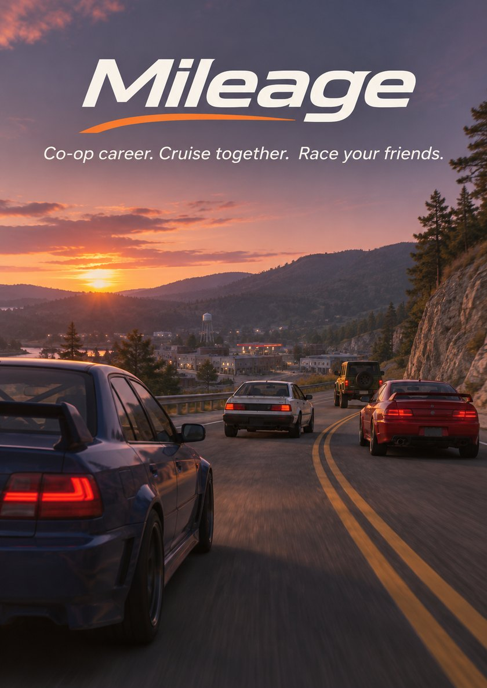

  

# Mileage
**Co-op career. Cruise together. Race your friends.**

Mileage is a multiplayer career for [BeamNG.drive](https://beamng.com/game/) on [BeamMP](https://beammp.com/). You and your friends play the career in one shared world: the same roads, traffic and signals. Race each other, pay each other, and keep your progress in your own save.

Mileage was called CareerMP until v0.3.0. CareerMP servers switch to Mileage on their own when they update.

## What works
- Joining a server and starting a career (BeamNG.drive 0.40.4.0)
- Buying a car, customising parts and parcel deliveries
- Drag racing another player on one tree
- Tuning, painting, insurance and repairs
- Seeing damage on other players' cars
- Paint sync
- Shared road traffic, police and parked cars
- Synced traffic lights, red-light cameras and speed traps
- Other players' cars shown correctly, with nametags hidden for traffic
- Chat
- Local saves: continue on any Mileage server, or offline

## Planned
- Mission and challenge props everyone sees (in progress, [#30](https://github.com/norto22/Mileage/issues/30))
- Paying and asking other players for money (in progress, [#33](https://github.com/norto22/Mileage/issues/33))
- Street races for money (in progress, [#105](https://github.com/norto22/Mileage/issues/105))
- Race events run by the server owner (in progress, [#106](https://github.com/norto22/Mileage/issues/106))
- A server leaderboard (in progress, [#107](https://github.com/norto22/Mileage/issues/107))
- Three or more players at once (in progress, [#32](https://github.com/norto22/Mileage/issues/32))
- Mod vehicles and longer render distance (in progress, [#100](https://github.com/norto22/Mileage/issues/100))
- Co-op jobs with split pay ([#89](https://github.com/norto22/Mileage/issues/89))
- Paying a player to tow or repair your car ([#91](https://github.com/norto22/Mileage/issues/91))
- Loans between players ([#88](https://github.com/norto22/Mileage/issues/88))
- Trading vehicles between players ([#39](https://github.com/norto22/Mileage/issues/39))
- Career races together ([#36](https://github.com/norto22/Mileage/issues/36))
- AI opponents in shared races ([#38](https://github.com/norto22/Mileage/issues/38))
- Bigger drag races ([#37](https://github.com/norto22/Mileage/issues/37))
- Watching other players' races ([#93](https://github.com/norto22/Mileage/issues/93))
- Bounties on players ([#92](https://github.com/norto22/Mileage/issues/92))
- Crews with a shared bank account ([#90](https://github.com/norto22/Mileage/issues/90))
- More maps than West Coast, USA ([#40](https://github.com/norto22/Mileage/issues/40))

Known problems are on the [issue tracker](https://github.com/norto22/Mileage/issues?q=is%3Aissue%20state%3Aopen%20label%3Abug).

## Install
You need BeamNG.drive 0.40.4.0, the current BeamMP server and the West Coast, USA map.

1. Download `Mileage-<version>.zip` from the latest [release](https://github.com/norto22/Mileage/releases/latest) and unpack it into your BeamMP server folder.
2. In `ServerConfig.toml`, set `MaxCars = 100` and `Map = "/levels/west_coast_usa/info.json"`.
3. Start the server. Type `Mileage Help` in the server console for its commands.

## Credits
Mileage began as [CareerMP](https://github.com/StanleyDudek/CareerMP) by **Dudekahedron** ([Dudek's Sandbox](https://discord.gg/caU5adg)). The port to BeamNG.drive 0.39, including multiplayer drag racing, is by Vlad Maksimenko ([CareerMP-0.39](https://github.com/vladmaksimenko-0/CareerMP-0.39)). Thanks to Bouboule, and to Lion and Luuk from BeamPaint, for the HTTP request examples the server plugin is built on.
